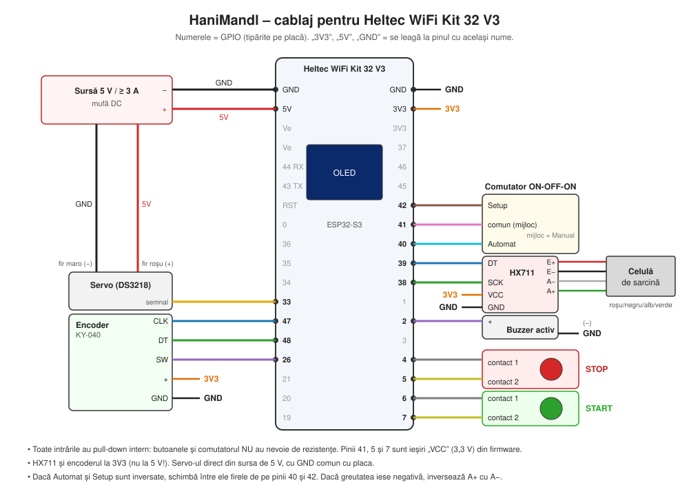

# 4. Cablaj (Heltec WiFi Kit 32 V3)



Pinii corespund blocului `HARDWARE_LEVEL == 3` din [`firmware/src/hanimandl.cpp`](../firmware/src/hanimandl.cpp)
(aceiași ca în [tabelul comunității Hiveeyes pentru V3](https://community.hiveeyes.org/t/kann-ich-auch-das-heltec-wifi-kit-32-in-der-neuen-version-v3-verwenden/4696/24?page=2),
link-ul indicat și de autorul modelului). Numerele GPIO sunt tipărite pe placă lângă fiecare pin.

## Tabel de conexiuni

| Componentă | Pin componentă | → Heltec V3 | Observații |
|------------|----------------|-------------|------------|
| **Sursă 5 V** | + | **5V** | Alimentează placa. |
| | − | **GND** | |
| **Servo** | semnal (portocaliu/galben) | **GPIO 33** | |
| | + (roșu) | **+5 V din sursă** | Direct din sursă, nu din pinul 3V3. |
| | − (maro/negru) | **GND** | GND comun cu placa! |
| **HX711** | VCC | **3V3** | **Nu la 5 V** – ESP32-S3 nu suportă 5 V pe intrări. |
| | GND | **GND** | |
| | DT (DOUT) | **GPIO 39** | |
| | SCK | **GPIO 38** | |
| **Celula de sarcină → HX711** | roșu / negru / alb / verde | E+ / E− / A− / A+ | Culorile pot varia; vezi foaia celulei. |
| **Encoder KY-040** | CLK | **GPIO 47** | |
| | DT | **GPIO 48** | |
| | SW | **GPIO 26** | Butonul encoderului = „OK / selectare”. |
| | + | **3V3** | |
| | GND | **GND** | |
| **Comutator 3 poziții** | pinul din mijloc (comun) | **GPIO 41** | Firmware-ul îl ține pe HIGH (face rol de „VCC”). |
| | extremitatea 1 | **GPIO 40** | → mod **Automat** |
| | extremitatea 2 | **GPIO 42** | → mod **Setup** |
| | *(poziția din mijloc)* | – | → mod **Manual** |
| **Buton START (verde)** | contact 1 | **GPIO 7** | „VCC” din firmware |
| | contact 2 | **GPIO 6** | |
| **Buton STOP (roșu)** | contact 1 | **GPIO 5** | „VCC” din firmware |
| | contact 2 | **GPIO 4** | |
| **Buzzer activ** | + | **GPIO 2** | |
| | − | **GND** | |

### Ordinea pinilor pe placă (orientativ)

Cu cele două șiruri de pini începând de la capătul cu GND:

```
 Șirul cu 5V              Șirul cu 3V3
 GND   ← sursă −           GND
 5V    ← sursă +           3V3  → HX711 VCC, encoder +
 Ve                        3V3
 Ve                        37
 44 RX                     46
 43 TX                     45
 RST                       42   → comutator (Setup)
 0                         41   → comutator (mijloc)
 36                        40   → comutator (Automat)
 35                        39   → HX711 DT
 34                        38   → HX711 SCK
 33  → servo semnal        1
 47  → encoder CLK         2    → buzzer +
 48  → encoder DT          3
 26  → encoder SW          4    → STOP
 21                        5    → STOP
 20                        6    → START
 19                        7    → START
```

Verifică întotdeauna eticheta tipărită pe placa ta înainte de a lipi.

## De ce nu sunt rezistențe?

- Intrările pentru butoane și comutator folosesc **pull-down intern** (`INPUT_PULLDOWN`), iar pinii
  41, 5 și 7 sunt setați de firmware ca ieșiri HIGH (3,3 V). Un buton apăsat leagă deci 3,3 V la intrare.
- Butonul encoderului (GPIO 26) folosește **pull-up intern** și trage la GND – modulul KY-040 face asta
  automat.

## Alimentare – reguli importante

1. **Servo-ul din sursa de 5 V**, nu din placă. Un servo de 20 kg·cm trage 1–3 A la pornire.
2. **GND comun**: minusul sursei, GND-ul servo-ului și GND-ul plăcii trebuie legate împreună,
   altfel servo-ul se mișcă aleator.
3. Opțional, un condensator de 470–1000 µF între 5 V și GND lângă servo previne resetarea plăcii
   când servo-ul pornește brusc.
4. **Nu conecta sursa externă și cablul USB în același timp** (când programezi, scoate mufa sursei).
5. Pinii **Ve** (Vext) nu se folosesc – ei alimentează ecranul OLED, pe care firmware-ul îl pornește
   singur prin GPIO 36.

## Cabluri între module

Unitatea de control e separată de cântar și de servo. În designul autorului cablurile ies direct prin
cele două găuri Ø6,1 din cutie (fără conectori). Dacă vrei să poți demonta modulele, poți folosi
conectori – atunci va trebui să mărești găurile:

| Legătură | Fire | Sugestie conector |
|----------|:----:|-------------------|
| Unitate control ↔ cântar (HX711) | 4 (3V3, GND, DT, SCK) | GX12 cu 4 pini |
| Unitate control ↔ servo | 3 (5 V, GND, semnal) | GX12 cu 3 pini sau prelungitor servo |
| Sursă → unitate control | 2 | mufă DC 5,5 × 2,1 mm |

Ține cablul HX711 cât mai scurt (sub ~1 m) și departe de firele servo-ului ca să eviți zgomotul în citire.
